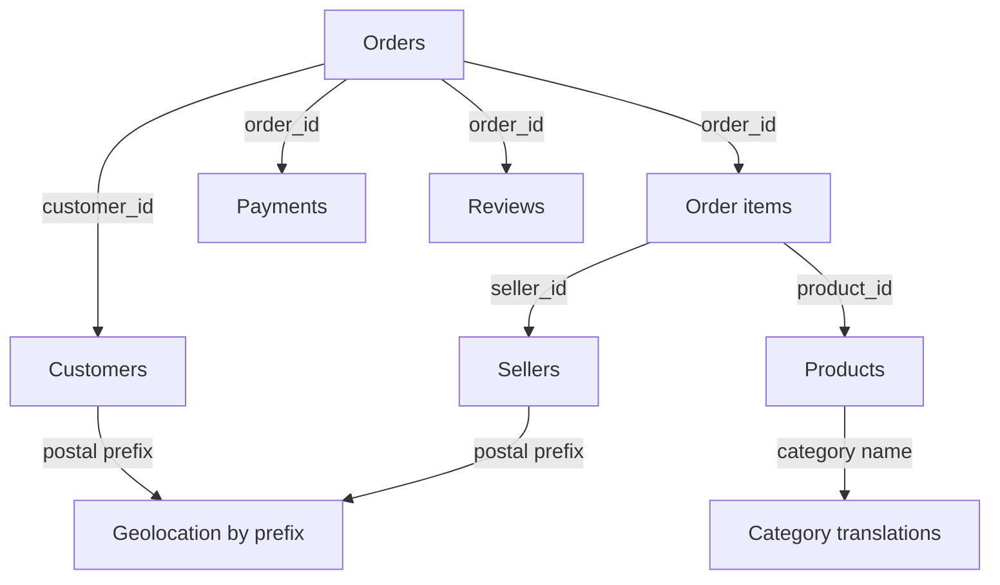

<div align="center">

# Olist E-Commerce Sales Analysis

**Sales, customer behavior, and delivery performance in Brazilian e-commerce**


[](https://www.kaggle.com/datasets/olistbr/brazilian-ecommerce)


[Overview](#overview) · [Dataset](#dataset) · [First findings](#first-findings) · [Roadmap](#roadmap) · [Run locally](#run-locally) · 

</div>

## Overview

A sales manager sees a strong month on the dashboard. Did more customers place orders, or did each order contain more merchandise? This project uses Olist transactions to work through that question and two others. Which customers, cities, and categories account for the most sales? Where do deliveries miss their promised dates?

The first release profiles every source table. Later stages will connect purchases to line items and customers, build monthly sales and delivery measures, and turn the results into a short management report.

## Dataset

The **Brazilian E-Commerce Public Dataset by Olist** contains anonymized orders placed on Brazilian marketplaces between 2016 and 2018. Olist provides nine CSV files. Each describes a different part of a purchase. [Dataset on Kaggle](https://www.kaggle.com/datasets/olistbr/brazilian-ecommerce) · [Download the CSV archive](https://www.kaggle.com/api/v1/datasets/download/olistbr/brazilian-ecommerce)

| Table | What one row describes | How we will use it |
|:--|:--|:--|
| Orders | One order | Status, purchase time, delivery date and promised date |
| Customers | One order-linked customer record | Join on `customer_id`, then track buyers across orders with `customer_unique_id` |
| Order items | One item within an order | Identify an item by `order_id` and `order_item_id`. Sum `price` for merchandise sales |
| Order payments | One payment entry within an order | Sum `payment_value` by order before comparing payments with item and freight totals |
| Order reviews | One recorded review entry | Examine scores, optional comments and coverage by order |
| Products | One product | Map `product_id` to a category |
| Sellers | One seller | Identify each item's seller and seller location |
| Geolocation | One location observation for a postal prefix | Summarize by prefix before joining coordinates to customers or sellers |
| Category translations | One category name and its English translation | Label product category charts |

### How the tables fit together



An order with two items and two payment entries produces four rows if both detail tables are joined directly on `order_id`. For order-level analysis, total each detail table separately before joining it to orders. Keep an item-level table for category rankings.

## First findings

| Observation from the raw files | What to check next |
|:--|:--|
| 99,441 order rows and 112,650 item rows | Check the uniqueness of `order_id` in orders and the composite item key before merging |
| 2,965 order rows (2.98%) lack an actual customer delivery timestamp | Count missing dates by order status before calculating delivery time |
| 58,247 review rows (58.70%) lack a written comment | Count available scores separately from written comments |
| 261,831 of 1,000,163 geolocation rows repeat a full earlier row | Inspect repeated prefixes again after removing exact duplicates in a working copy |

Source outputs from stage 01: [table inventory](reports/tables/table_inventory.csv) · [column profile](reports/tables/column_profile.csv). The duplicate count uses pandas `duplicated()`, which counts occurrences after the first. The profile records loaded types before any date conversion.

## Roadmap

| Stage | Deliverable | Status |
|:--|:--|:--|
| 01 · Inspect | Inventory of all nine tables, types, missing values, exact duplicates | **Completed** |
| 02 · Clean | Parsed dates, key checks, documented decisions on missing values and duplicates | Next |
| 03 · Join | Order-level and item-level tables, checked against source totals | Planned |
| 04 · Build features | Merchandise value per order, purchase month, delivery days and late flag | Planned |
| 05 · Calculate KPIs | Merchandise sales, average order value, distinct orders and buyers | Planned |
| 06 · Analyze sales and customers | Monthly trends, repeat purchases, top customers, cities and categories | Planned |
| 07 · Analyze delivery and plot results | Late deliveries by region, monthly sales chart and ranking charts | Planned |
| 08 · Report | Executive summary with evidence, recommended actions and limitations | Planned |

### Planned metric definitions

| Measure | Working definition |
|:--|:--|
| Merchandise sales (BRL) | Sum of item prices on delivered orders. Freight is tracked separately |
| Average order value (BRL) | Merchandise sales divided by distinct delivered orders with item values. Report any excluded orders |
| Customers and repeat buyers | Distinct `customer_unique_id` values for delivered orders. A repeat buyer has at least two distinct delivered orders during the observed period |
| Sales month | Calendar month of purchase for the qualifying orders. Flag partial months in trend charts |
| Delivery time and late rate | Days elapsed from purchase to delivery. A delivery is late if its actual calendar date is after its estimated date. Divide late deliveries by delivered orders with both dates |

## Run locally

Use Python 3.11 with pandas. From the repository root, install the dependency, extract all nine CSVs directly into `data/raw/`, then run the inspection.

```bash
python -m pip install -r requirements.txt
python scripts/01_inspect_data.py
```

Open `reports/tables/table_inventory.csv` first and find the table with the most repeated rows. Then open `column_profile.csv` and compare missing delivery dates with missing review comments. The script rereads the raw files on each run and replaces the two summary CSVs.

## Repository structure

```text
olist-ecommerce-sales-analysis/
├── README.md
├── requirements.txt
├── .gitignore
├── data/
│   ├── raw/                       # Extract the nine source CSVs here
│   └── processed/                 # Clean tables from later stages
├── scripts/
│   └── 01_inspect_data.py
├── reports/
│   └── tables/
│       ├── table_inventory.csv
│       └── column_profile.csv
├── assets/
│   └── figures/                   # Charts for the management report
└── docs/
    └── 
```

## Next step

Group orders by `order_status` and count missing values in `order_delivered_customer_date` within each group. Record both the count and the percentage. This tells us which rows need investigation before we measure delivery performance.
