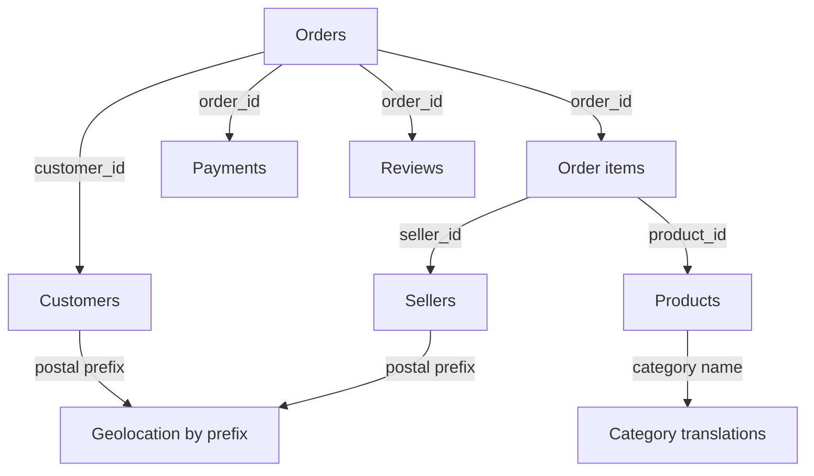
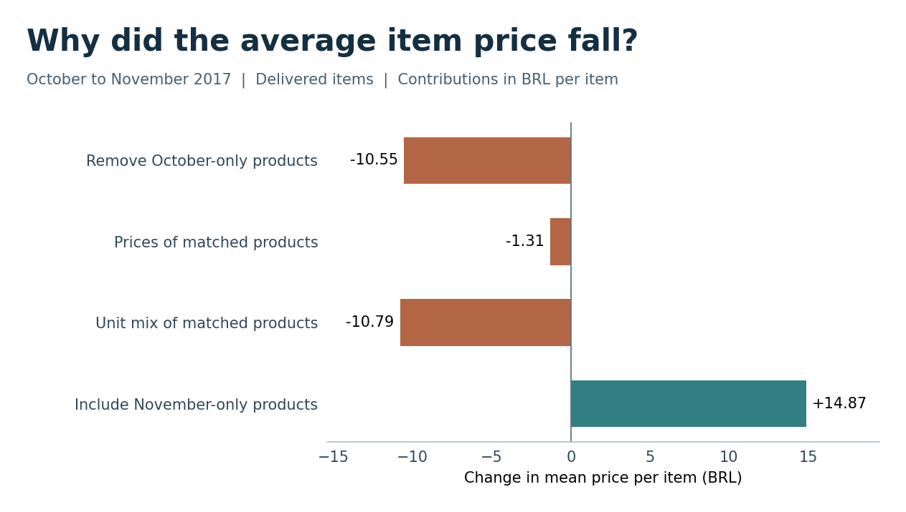

<div align="center">

# Olist E-Commerce Sales Analysis

**Sales, customer behavior, and delivery performance in Brazilian e-commerce**


[](https://www.kaggle.com/datasets/olistbr/brazilian-ecommerce)


[Overview](#overview) · [Dataset](#dataset) · [Results](#results) · [Script guide](#script-guide) · [Run locally](#run-locally)

</div>

## Overview

A sales manager sees a strong month on the dashboard. Did more customers place orders, or did each order contain more merchandise? This project uses Olist transactions to work through that question and two others. Which customers, cities, and categories account for the most sales? Where do deliveries miss their promised dates?

Thirteen numbered scripts take the raw files from inspection to sales, customer and delivery results. Each script prints a short summary. Detailed results are available in CSV tables and seven figures.

## Dataset

The **Brazilian E-Commerce Public Dataset by Olist** contains anonymized orders placed on Brazilian marketplaces between 2016 and 2018. Olist provides nine CSV files. Each describes a different part of a purchase. [Dataset on Kaggle](https://www.kaggle.com/datasets/olistbr/brazilian-ecommerce) · [Download the CSV archive](https://www.kaggle.com/api/v1/datasets/download/olistbr/brazilian-ecommerce)

| Table | What one row describes | How we will use it |
|:--|:--|:--|
| Orders | One order | Status, purchase time, delivery date and promised date |
| Customers | One order-linked customer record | Join on `customer_id`, then track buyers across orders with `customer_unique_id` |
| Order items | One item within an order | Identify an item by `order_id` and `order_item_id`. Sum `price` for merchandise sales |
| Order payments | One payment entry within an order | Sum `payment_value` by order before comparing payments with item and freight totals |
| Order reviews | One recorded review entry | Examine scores, optional comments and coverage by order |
| Products | One product | Map `product_id` to a category |
| Sellers | One seller | Identify each item's seller and seller location |
| Geolocation | One location observation for a postal prefix | Summarize by prefix before joining coordinates to customers or sellers |
| Category translations | One category name and its English translation | Label product category charts |

### How the tables fit together



An order with two items and two payment entries produces four rows if both detail tables are joined directly on `order_id`. For order-level analysis, total each detail table separately before joining it to orders. Keep an item-level table for category rankings.

## Results

| Business question | Result | Detail |
|:--|:--|:--|
| How much merchandise was sold? | **R$ 13,221,498.11** across **96,478 delivered orders**, averaging **R$ 137.04** per order. Freight totaled R$ 2,198,275.64. | [Sales KPIs](reports/tables/07_sales_kpis.csv) |
| Which purchase month led sales? | **November 2017**, with R$ 987,765.37 in merchandise sales. | [Monthly totals and growth](reports/tables/08_monthly_sales.csv) |
| How often did buyers return? | **2,801 of 93,358 buyers (3.00%)** placed at least two delivered orders within the observation window. | [Customer KPIs](reports/tables/10_customer_kpis.csv) |
| How often did deliveries miss the promise? | **6,534 of 96,470 evaluated orders (6.77%)** arrived after the promised calendar day. The other eight delivered orders lack an actual delivery timestamp. | [Delivery outcomes](reports/tables/05_delivery_outcomes.csv) |
| Which city and category led merchandise sales? | **São Paulo / SP** led cities with R$ 1,859,556.83. **Health & Beauty** led categories with R$ 1,233,131.72. | [Cities](reports/tables/11_city_sales.csv) · [Categories](reports/tables/12_category_sales.csv) |


The monthly table covers all observed purchase months for delivered orders, including months with zero qualifying orders. The three trend charts use the original January 2017 to August 2018 display window. Interpret the first and last observed months with care because the observation window can cut through a month. A missing growth rate means the previous month was absent or had zero sales.


**Reading the counts.** An order qualifies for sales when its status is delivered and its items have a merchandise value. The duration measure also requires a valid purchase and actual delivery date with a nonnegative interval. The late rate additionally requires a promised date. Delivery on the promised calendar day counts as on time.

[Order count trend](assets/figures/09_plot_monthly_trends/order_count.png) · [Average order value trend](assets/figures/09_plot_monthly_trends/average_order_value.png) · [City ranking](assets/figures/11_rank_cities/top_sales.png) · [Category ranking](assets/figures/12_rank_product_categories/top_sales.png)

### October and November 2017 by product

The mean selling price per delivered item fell from **R$ 124.33 to R$ 116.55**. Of 920 product IDs sold in both months, 156 had a lower mean price, 121 a higher one, and 643 the same. These counts weight every product equally. The decomposition below weights each product by units sold.

| Contribution to the overall change | BRL per item |
|:--|--:|
| Restrict October to products also sold in November | −10.55 |
| Change in selling prices among the matched products | −1.31 |
| Change in unit shares among the matched products | −10.79 |
| Expand November to include products sold only in November | +14.87 |
| **Total change** | **−7.78** |

The comparison moves from October's full basket to the October matched basket, then to the November matched basket, and finally to November's full basket. Average unit shares and prices across both months split the matched change symmetrically. The net product mix contribution was **−R$ 6.47 (83.2% of the overall fall)** under this method. A product observed in only one month has no observed price in the other month. Changes in observed selling prices can also reflect different sellers.



## Run locally

Use Python 3.11. Extract the nine source CSVs directly into `data/raw/`. Run the commands below from the repository root. The scripts also work from an IDE with the same Python environment.

```bash
python -m pip install -r requirements.txt
python scripts/01_inspect_data.py
```

Continue in the numbered order below. To reproduce all stages from a Windows PowerShell terminal:

```powershell
Get-ChildItem scripts/[0-9]*.py | Sort-Object Name | ForEach-Object {
    python $_.FullName
    if ($LASTEXITCODE -ne 0) { throw "Stage failed: $($_.Name)" }
}
```

## Script guide

| Script | What to learn | Input stage | Result to inspect |
|:--|:--|:--|:--|
| [01_inspect_data.py](scripts/01_inspect_data.py) | Read nine CSVs, count missing values and exact duplicates | Raw files | [Table inventory](reports/tables/table_inventory.csv) · [Column profile](reports/tables/column_profile.csv) |
| [02_check_order_dates.py](scripts/02_check_order_dates.py) | Check order keys and distinguish missing dates from parsing errors | Raw orders | [Date checks](reports/tables/02_date_checks.csv) |
| [03_check_delivery_records.py](scripts/03_check_delivery_records.py) | Group missing dates by status and flag contradictory records | 02 | [Status counts](reports/tables/03_dates_by_status.csv) · [Flagged orders](reports/tables/03_delivery_exceptions.csv) |
| [04_measure_delivery_times.py](scripts/04_measure_delivery_times.py) | Subtract timestamps and interpret the median and percentiles | 02 | [Duration statistics](reports/tables/04_duration_stats.csv) |
| [05_compare_delivery_dates.py](scripts/05_compare_delivery_dates.py) | Compare calendar days and calculate delay severity among late orders | 04 | [Outcomes](reports/tables/05_delivery_outcomes.csv) · [Late orders only](reports/tables/05_late_delay_stats.csv) |
| [06_build_order_totals.py](scripts/06_build_order_totals.py) | Check item keys, group items and join totals to orders | 02 + raw items | [Join checks](reports/tables/06_item_join_checks.csv) |
| [07_calculate_sales_kpis.py](scripts/07_calculate_sales_kpis.py) | Define the sales population and calculate average order value | 06 | [Sales KPIs](reports/tables/07_sales_kpis.csv) |
| [08_analyze_monthly_sales.py](scripts/08_analyze_monthly_sales.py) | Group by purchase month, fill missing months and calculate growth | 07 | [Monthly table](reports/tables/08_monthly_sales.csv) |
| [09_plot_monthly_trends.py](scripts/09_plot_monthly_trends.py) | Read a summary table and plot sales, order count and average order value | 08 | [Monthly charts](assets/figures/09_plot_monthly_trends/) |
| [10_analyze_repeat_customers.py](scripts/10_analyze_repeat_customers.py) | Join customers and count distinct orders per buyer | 07 + raw customers | [Buyer KPIs](reports/tables/10_customer_kpis.csv) · [Top 10 customers](reports/tables/10_top_customers.csv) |
| [11_rank_cities.py](scripts/11_rank_cities.py) | Rank city and state pairs by merchandise sales | 10 | [City sales](reports/tables/11_city_sales.csv) |
| [12_rank_product_categories.py](scripts/12_rank_product_categories.py) | Join products and translations to delivered items, then reconcile category sales | 07 + raw items, products and translations | [Category sales](reports/tables/12_category_sales.csv) |
| [13_compare_product_prices.py](scripts/13_compare_product_prices.py) | Match product IDs across two months and separate price from unit mix | Raw orders and items | [Product comparison](reports/tables/13_product_price_comparison.csv) · [Contributions](reports/tables/13_price_effects.csv) |

## Repository structure

| Folder | Contents |
|:--|:--|
| `data/raw/` | The nine original Olist CSVs, downloaded separately |
| `data/processed/` | Intermediate order, delivery and customer tables generated locally |
| `scripts/` | Thirteen numbered scripts. The two shared modules contain paths and chart formatting |
| `reports/tables/` | Small CSV reports. Files from steps 02–13 start with their step number |
| `assets/figures/` | Exported charts grouped by the script that produced them |

## Next step

Rank matched products by their contribution to the change in unit mix, then group contributions by category to identify where buying patterns shifted most.
